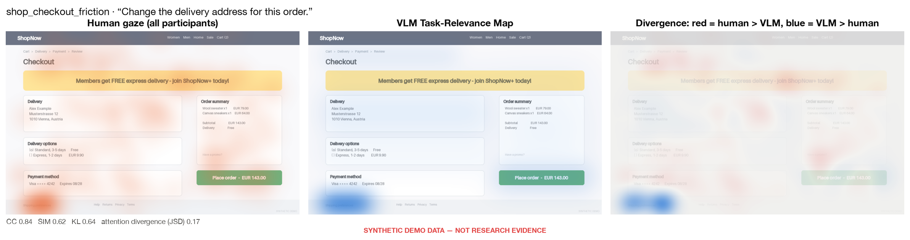
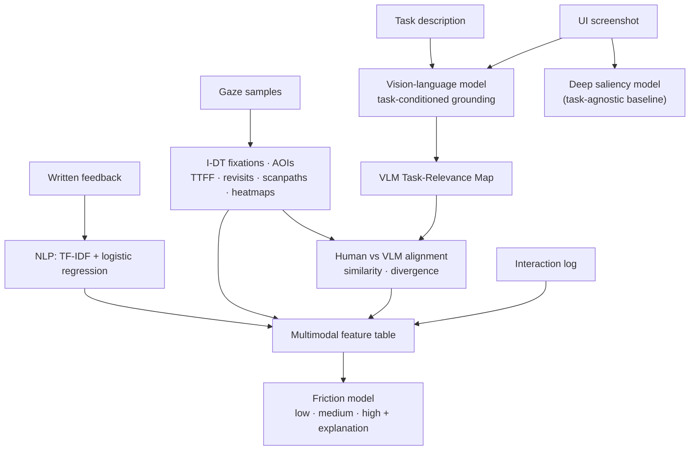
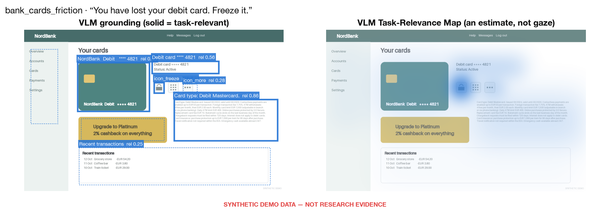
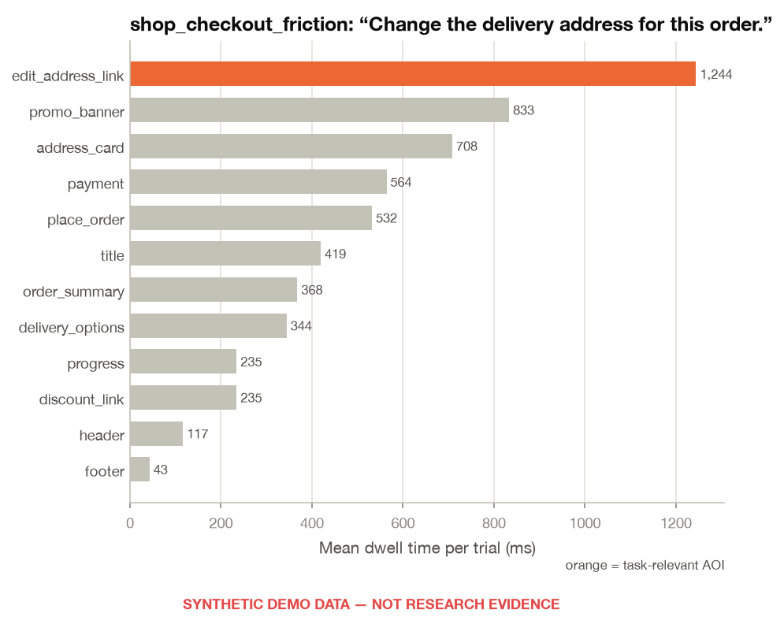
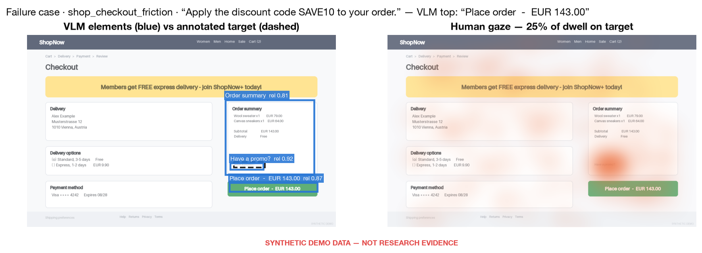

# GazeGrounded UX

**Task-aware multimodal detection of UX friction using human gaze, vision-language models, deep learning, interaction data and NLP.**

> GazeGrounded UX explores whether disagreement between human visual attention and task-aware
> Vision-Language Model predictions can reveal friction in user interfaces.

[](.github/workflows/tests.yml)


> [!IMPORTANT]
> **No real participant data has been collected yet.** Everything you can run today uses
> **synthetic demo data**, which shows that the software works end to end. Numbers on synthetic
> data are not findings. Results on real data: **experimental results pending.**



*Synthetic demo. Left: where simulated participants looked. Middle: where a task-aware model
estimates the task-relevant information is. Right: red = attention the model did not expect,
blue = expected attention that people did not give.*

---

## Why this project?

Usability studies show *that* people struggle: a task takes long, fails, or gets a low ease
rating. They are less good at showing *why*. Eye tracking adds where people looked. Modern
vision-language models (VLMs) add something new: given a screenshot **and the user's task**, a VLM
can estimate which interface elements matter for that task.

When people's gaze goes somewhere other than where the task-relevant information is, that gap may
point to the cause of the friction: the right control exists but is not found (findability), it
is found but not recognised (ambiguous wording), or attention is pulled elsewhere (visual
hierarchy). GazeGrounded UX builds the whole pipeline needed to test this idea rigorously.

## Research questions

| | Question | How it is tested |
|---|---|---|
| **RQ1** | How closely does task-conditioned VLM relevance align with human visual attention? | Map metrics (CC, SIM, KL, NSS) against three task-agnostic baselines: centre bias, spectral-residual saliency, a trained deep saliency model |
| **RQ2** | Does human/VLM attention divergence co-vary with behavioural friction? | Repeated-measures correlation with completion time, revisits and TTFF; paired clean-vs-friction tests on participant means |
| **RQ3** | Do gaze, interaction, VLM and text signals together predict friction better than each alone? | Grouped cross-validation (new participants; new interfaces), macro-F1 and quadratic weighted kappa against a majority-class reference |
| RQ4 | Which modalities contribute most? | Leave-one-modality-out ablation, permutation importance |

## System overview



## Example

<table>
<tr>
<td width="50%"><br><sub>Task-conditioned grounding for “You have lost your debit card. Freeze it.” on the friction variant, where the freeze action is a padlock icon without a label.</sub></td>
<td width="50%"><br><sub>Mean dwell per AOI. The promo banner absorbs more attention than the target link.</sub></td>
</tr>
</table>


## Modalities

| Modality | Source | Examples of features |
|---|---|---|
| **Gaze** | eye tracker / WebGazer samples → I-DT fixations | TTFF on target, fixation count, mean fixation duration, revisits, AOI transitions, scanpath length, task-relevant attention |
| **Interaction** | task log | completion time, clicks, errors, success |
| **Vision (VLM)** | screenshot + task → grounded elements | relevance statistics; human/VLM similarity; **early attention divergence** |
| **Language** | post-task comment | predicted feedback category (TF-IDF + LR, fitted inside each CV fold) |
| Visual (optional) | screenshot only | AOI count, edge density, saliency entropy |

## Pipeline

1. **Data** — adapters convert each source (synthetic, UEyes, own study) into one validated schema (pydantic): gaze samples, trials, AOIs, tasks. PII-looking columns are rejected.
2. **Gaze** — I-DT fixation detection (Salvucci & Goldberg, 2000), AOI assignment with a margin for tracker accuracy, TTFF/dwell/revisits/transitions, AOI scanpaths, Gaussian heatmaps.
3. **VLM** — a provider interface (mock · local Hugging Face · HTTP-served) returns strict JSON (element, role, box, task relevance, attention priority, reason). A never-raising parser validates it; raw responses are cached by image checksum + task + model + prompt version.
4. **Human vs VLM** — boxes become a continuous *VLM Task-Relevance Map*, compared with gaze maps (CC, SIM, KL, JSD, NSS) and at AOI level.
5. **Deep learning** — a ResNet18 + FPN-lite decoder predicts gaze heatmaps from screenshots (loss = α·MSE + β·KL).
6. **NLP** — feedback classification and exploratory topics.
7. **Fusion** — trial-level features → logistic regression / random forest, grouped CV, explanations.
8. **Statistics & report** — RQ1–RQ4 analyses and a generated Markdown report.
9. **Dashboard** — Streamlit app to explore any trial and the model results.

## Repository structure

```text
configs/          YAML configs (base, synthetic, fast_dev, ueyes, experiment)
src/gazegrounded/ package: data/ gaze/ vlm/ vision/ nlp/ multimodal/ analysis/ visualization/
                  pipeline.py (stages) · cli.py
dashboard/        Streamlit app (trial explorer + 4 pages)
study/            protocol, consent, questionnaire and the WebGazer browser study
notebooks/        01–06, executed; import the package, contain no core logic
scripts/          thin wrappers around the CLI
tests/            pytest suite incl. an end-to-end CLI smoke test
reports/          model card, dataset card, limitations, experiment template
data/             README only — data is generated or downloaded locally, never committed
```

## Quick start

Requires Python 3.11+ (developed on 3.13, macOS/Apple silicon; CPU-only works).

```bash
python -m venv .venv && source .venv/bin/activate
pip install -e ".[dev]"
pytest                                   # ~95 tests, < 1 minute
python -m gazegrounded.cli run-all       # synthetic demo, ~1 minute, $0
streamlit run dashboard/app.py           # open the dashboard
```

## Demo (synthetic data)

`run-all` runs every stage; each can also run on its own:

```bash
python -m gazegrounded.cli generate-demo     # 5 UIs, 12 participants, 120 trials
python -m gazegrounded.cli preprocess        # adapter -> validation -> data/processed/
python -m gazegrounded.cli gaze-analysis     # fixations, metrics, scanpaths, heatmaps
python -m gazegrounded.cli vlm-analysis      # mock VLM, relevance maps, alignment
python -m gazegrounded.cli train-saliency    # add --device cpu|mps|cuda, --fast-dev-run
python -m gazegrounded.cli nlp-analysis
python -m gazegrounded.cli train-friction    # builds features, compares modalities
python -m gazegrounded.cli evaluate          # RQ1–RQ4 -> reports/generated/<source>/report.md
python -m gazegrounded.cli build-study       # study stimuli + tasks.json
```

Every command takes `--config` and `--set key=value` (e.g. `--set seed=7`). `make demo`,
`make test` and `make dashboard` are shortcuts. Each training run writes
`experiments/<timestamp>-<name>/` with `config.yaml`, `metrics.json`, `predictions.csv` and
`feature_importance.csv`.

**How the synthetic data is built.** A hidden friction severity per trial (designed UI friction
+ participant susceptibility + noise) drives simulated visual search, revisits, errors and
templated feedback; labels are a noisy binning of that severity. The generator *assumes* the
effects the study will test, so any “effect” in the demo is put there by construction.

## Working with real data

* **Own study** — run the browser study (below), place exports in `data/raw/study/sessions/`,
  then `python -m gazegrounded.cli run-all --config configs/experiment.yaml`.
* **UEyes** (Jiang et al., CHI 2023; CC BY 4.0) — download from Zenodo, see
  [data/README.md](data/README.md); use `configs/ueyes.yaml` for gaze analysis and training the
  saliency model. UEyes is free-viewing (no tasks or labels), so it cannot test RQ2/RQ3.

Licences of third-party data are the user's responsibility; no third-party data is redistributed.

## VLM analysis

The VLM receives the screenshot **and the task** and is asked about *task relevance* — not just
“where would someone look”. That is the difference from image classification or task-free saliency:
the same checkout page has different relevant regions for “change the address” and “apply a
discount code”. Grounding means the model must also say *where* (a bounding box), so its
reasoning can be compared with gaze.

| Provider | Use | Notes |
|---|---|---|
| `mock` | demo, tests | **Not a VLM.** Lexical scoring of annotated AOI descriptions; deterministic |
| `local` | real analysis, $0 | Hugging Face `Qwen/Qwen2.5-VL-3B-Instruct` via transformers 5 (`pip install -e ".[vlm]"`); pixel boxes |
| `http` | optional | any model served behind a chat-completions API, e.g. a local Ollama / vLLM / LM Studio server (`VLM_API_BASE_URL` in `.env`) |

```bash
python -m gazegrounded.cli vlm-analysis --config configs/experiment.yaml --set vlm.provider=local
```

The VLM map is the model's **estimate of task-relevant regions**. It is not a measurement or
prediction of gaze, and the project never treats it as a window into cognition.

## Deep learning

`vision/saliency_model.py`: ImageNet ResNet18 encoder, FPN-style decoder (~11.5 M parameters),
trained on screenshot → gaze-heatmap pairs with α·MSE + β·KL (KL matches the *distribution* of
attention; MSE stabilises early training). Train/validation splits are by interface pair, so a
clean and a friction variant of the same page never straddle the split. Early stopping,
checkpoints (`best_model.pt`, git-ignored), CPU/MPS/CUDA, `--fast-dev-run`. It serves as the
task-agnostic baseline C in RQ1 and is evaluated only on held-out screens.

## NLP

Post-task answers to “What made this task easy or difficult?” are cleaned lightly (negations
kept), represented with TF-IDF and classified with logistic regression into findability,
visual hierarchy, ambiguous wording, information overload, feedback uncertainty, navigation,
no friction, other. TF-IDF + LR is the interpretable baseline: on a few hundred short comments it
is hard to beat and every coefficient can be inspected. KMeans topics are exploratory only.

## Multimodal friction detection

Early fusion of the modality features into one scikit-learn pipeline. Every learned step
(imputation, scaling, the text classifier) is refit inside each training fold. Models: logistic
regression (interpretable baseline), random forest, majority class (chance reference).
Explanations: standardised coefficients, permutation importance on held-out folds, and per-trial
contributions shown in the dashboard.

**Data splitting.** `GroupKFold` by participant (generalising to new people) and by interface
(generalising to new screens). Rows are never split at random, and a test asserts zero group
overlap on every fold.

## Dashboard

```bash
streamlit run dashboard/app.py
```

* **Trial explorer**: interface and task, behavioural metrics, interactive gaze heatmap,
  fixations sized by duration, numbered scanpath, VLM boxes and map, divergence map, feedback
  with the out-of-fold NLP category, and why the model predicted its friction level.
* Pages: Human vs VLM (RQ1 baselines), Friction models (RQ3/RQ4), Failure cases (with saved
  interpretations), Methodology.


## Methodology

* **Fixations**: I-DT, 80 px / 100 ms (lab); 120 px for webcam data. AOIs padded by about the
  tracker's accuracy (20 px lab, 40 px webcam).
* **Heatmaps**: duration-weighted, Gaussian σ ≈ 1° visual angle, compared on a 1/8 grid.
* **Attention divergence**: Jensen–Shannon divergence (base 2, range 0–1) between the gaze
  heatmap and the VLM map. The **primary** measure uses only the first 8 fixations after the
  onset fixation (`attention_divergence_early`). Validating the pipeline showed that
  whole-trial divergence is confounded by fixation count: a sparse map from a short, easy trial
  looks “divergent” from any smooth map. This choice was made before any real data existed and
  must stay fixed for the real study.
* **Statistics**: repeated-measures correlation (trials nested in participants) as primary;
  trial-level correlations exploratory only; paired tests on participant means, with the test
  pre-specified in config; effect sizes; Holm correction within pre-declared families.
* **Experiment template**: every analysis reports hypothesis, variables, dataset, split, model,
  metrics, result, interpretation and limitation ([reports/experiment_template.md](reports/experiment_template.md)).

## Results

**Experimental results pending.** No real participant data has been collected.

<details>
<summary><b>Synthetic demo output (pipeline verification only — not findings)</b></summary>

These outputs only show that each stage runs and produces sensible artefacts. The generator
put these patterns into the data.

| | |
|---|---|
|  |  |
|  |  |

Generate the full report locally with `python -m gazegrounded.cli evaluate`
(`reports/generated/synthetic/report.md`).
</details>

## Failure-case analysis

`evaluate` lists every task where the VLM's top element is not the annotated target, with
the screenshot, task, VLM output, human gaze and the dwell share on the target. Typical
categories to look for with a real VLM: icon meaning misunderstood, text too small, several
similar buttons, task depends on hidden content or scrolling, and elements that are
semantically right but visually ignored. With the mock provider these cases only demonstrate
the tooling.



## Limitations

See [reports/limitations.md](reports/limitations.md). In short:
* Gaze shows where people looked, not what they understood.
* Webcam gaze is far less accurate and precise than lab eye trackers.
* VLM grounding can be wrong, and confident when wrong.
* Samples will be small.
* Static screenshots stand in for multi-step interactions.
* Synthetic results demonstrate the software only.

## Ethical considerations

Gaze is behavioural data that can reveal attention, reading ability and possibly health-related
traits. The study collects pseudonymous codes only, never stores webcam video, keeps data local
until the participant chooses to export it, and supports withdrawal at any point. See
[study/consent_template.md](study/consent_template.md),
[reports/dataset_card.md](reports/dataset_card.md) and [reports/model_card.md](reports/model_card.md).
Do not send screenshots containing personal or confidential data to externally hosted models.

## Roadmap

- [ ] Ethics approval and a pilot (3–5 participants) of the WebGazer study
- [ ] Main study (target ≥ 24 participants, counterbalanced) and researcher-coded friction labels
- [ ] Real VLM runs (Qwen2.5-VL locally, plus a second open model for comparison) with failure-case coding
- [ ] Saliency model trained on UEyes, evaluated on held-out interfaces
- [ ] Confirmatory RQ2 analysis exactly as specified in `analysis/research.py`
- [ ] Optional: lab eye-tracker replication; late-fusion and sequence models of scanpaths

## Author

**Morvarid Kaviani** · [www.morvaridkaviani.com](https://www.morvaridkaviani.com)

## Citation

If you use this software, please cite it using [CITATION.cff](CITATION.cff).

## Licence

MIT for the code (see [LICENSE](LICENSE)). WebGazer.js (GPL-3.0-or-later) is loaded from a CDN
by the study prototype and is not redistributed here. Third-party datasets and models keep
their own licences.
