<div align="center">

# GazeGrounded UX

**Where people look versus where the task needs them to look.**

A research toolkit that detects UX friction by comparing human eye-tracking data with a
task-aware vision-language model's estimate of the task-relevant parts of an interface,
together with interaction logs and what participants say.

[Live demo](https://morvaridkaviani.github.io/GazeGrounded-UX/) ·
[Run it locally](#quick-start) ·
[Use it in your research](#use-it-in-your-own-research) ·
[Study kit](study/README.md)


</div>

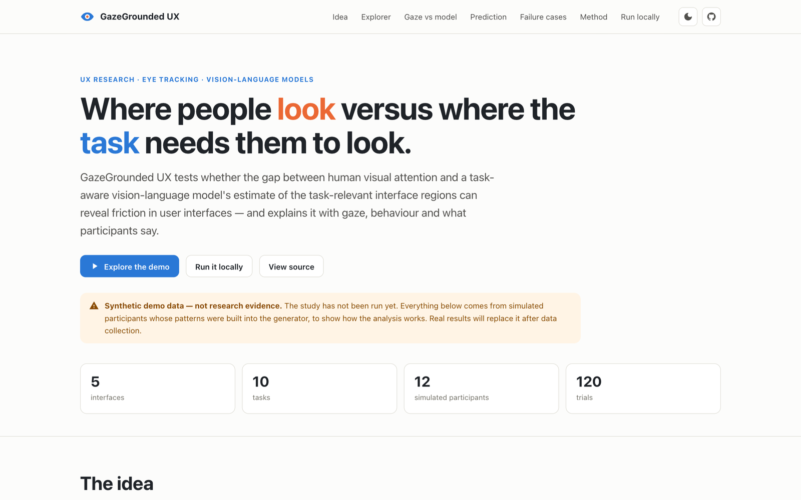

> [!IMPORTANT]
> **The participant study has not been run yet.** Everything shown here uses **synthetic demo
> data**: simulated participants whose behaviour was generated to demonstrate the analysis.
> These numbers are not research findings. Real results will be added after data collection.

---

## What it does

Usability tests show *that* people struggle. Eye tracking shows *where* they looked. GazeGrounded
UX adds a third view: given a screenshot **and the user's task**, a vision-language model (VLM)
estimates which interface elements matter for that task. Comparing where people looked with where
the task-relevant information is helps explain *why* a task was hard:

- **Findability**: the right control exists, but people don't find it.
- **Recognition**: people look at it but don't recognise it, e.g. an unlabelled icon.
- **Distraction**: attention is pulled elsewhere, e.g. by a promotional banner.

The toolkit covers the whole workflow:
- a browser-based webcam eye-tracking study
- gaze analysis
- VLM grounding
- a deep-learning saliency baseline
- feedback text analysis
- a multimodal friction model
- statistics
- an interactive dashboard and a static website.

## Screenshots

| Trial explorer | Gaze vs model, per task |
|---|---|
| 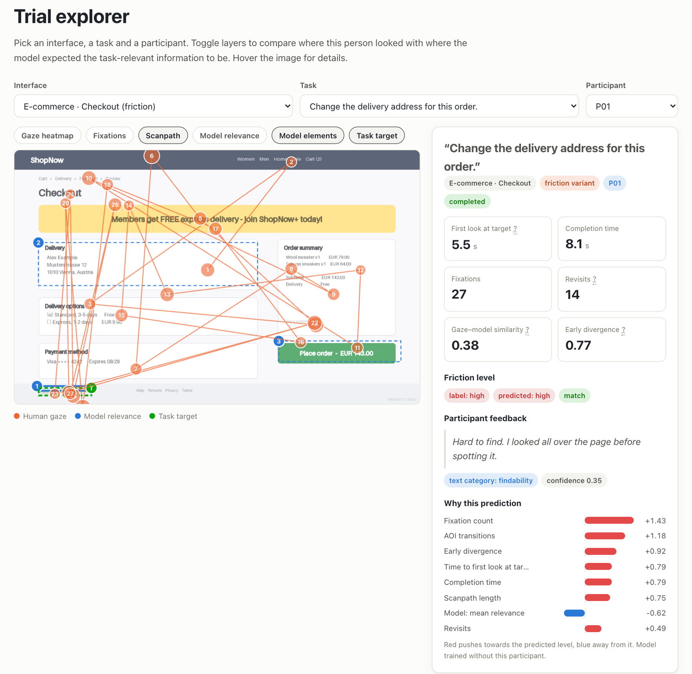 | 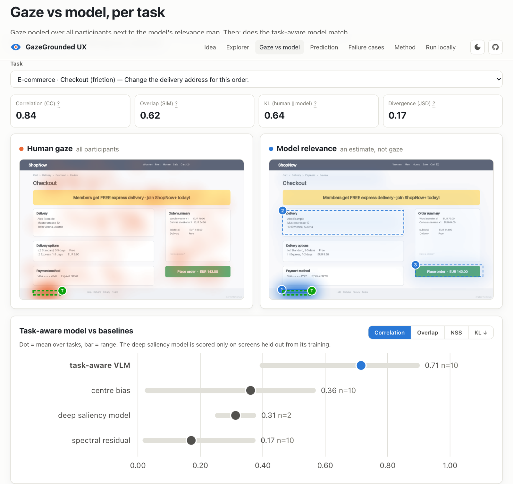 |
| **Predicting friction** | **Failure cases** |
| 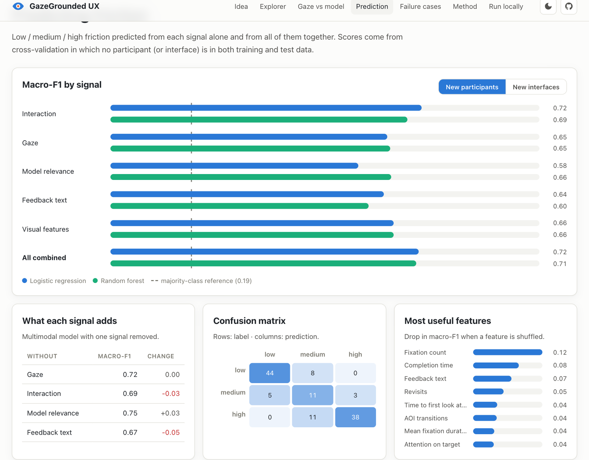 | 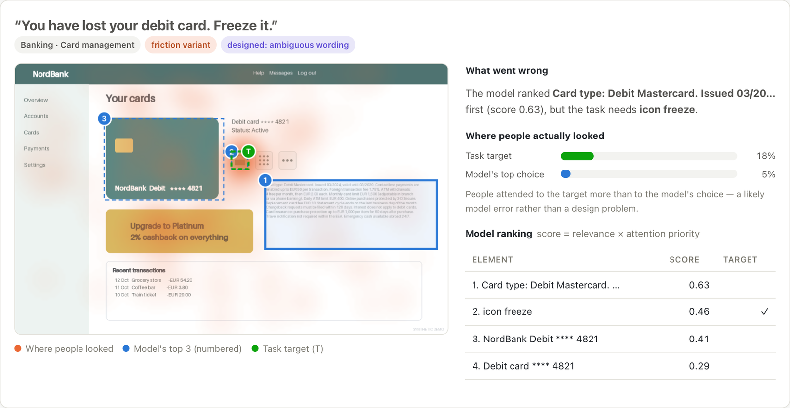 |

<details>
<summary><b>Dark mode and the analysis dashboard</b></summary>

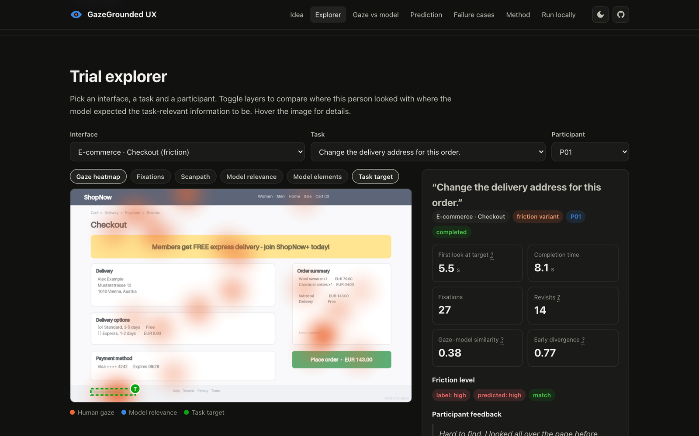

The Streamlit dashboard offers the same views for local analysis, and lets you record your own
interpretation of each failure case:

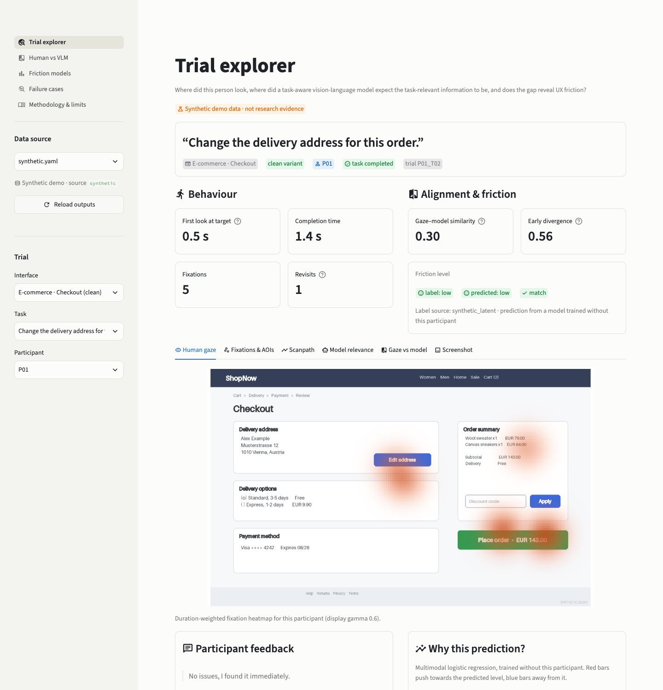
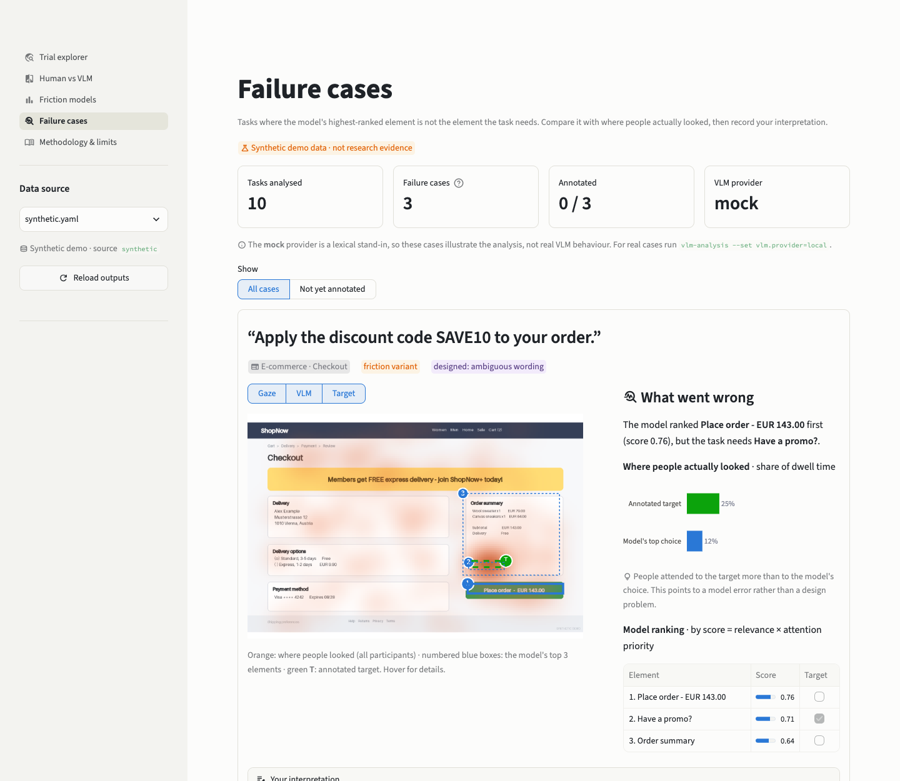
</details>

## Research questions

| | Question | How it is tested |
|---|---|---|
| **RQ1** | How closely does task-conditioned VLM relevance align with human visual attention? | Map metrics (CC, SIM, KL, NSS) against task-agnostic baselines: centre bias, spectral-residual saliency and a trained deep saliency model |
| **RQ2** | Does the divergence between gaze and VLM relevance co-vary with behavioural friction? | Repeated-measures correlation with completion time, revisits and time to first fixation; paired clean-vs-friction tests |
| **RQ3** | Do gaze, interaction, VLM and text signals together predict friction better than each alone? | Cross-validation grouped by participant and by interface; macro-F1 and quadratic weighted kappa against a majority-class reference |
| RQ4 | Which signals contribute most? | Leave-one-signal-out ablation and permutation importance |

## How it works

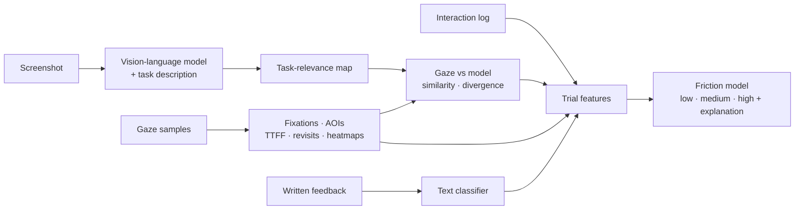

1. **Data**: adapters convert each source (synthetic demo, UEyes, the webcam study) into one
   validated format. Columns that look like personal data are rejected.
2. **Gaze**:
   - I-DT fixation detection (Salvucci & Goldberg, 2000)
   - areas of interest (AOIs) padded by the tracker's accuracy
   - time to first fixation (TTFF), dwell, revisits, transitions, scanpaths
   - duration-weighted heatmaps.
3. **VLM grounding**: the model returns the task-relevant elements as structured JSON (label, role,
   box, relevance, attention priority, reason). Responses are validated and cached. These boxes
   become a continuous **task-relevance map**.
4. **Comparison**: gaze maps against the relevance map (CC, SIM, KL, JSD, NSS) and per AOI. The
   primary measure is **early divergence**, computed over the first 8 fixations.
5. **Deep learning**: a ResNet18 encoder with an FPN-style decoder predicts gaze heatmaps from
   screenshots. It serves as a task-agnostic baseline.
6. **Text**: participants' comments are classified into friction categories with TF-IDF and
   logistic regression.
7. **Fusion and statistics**: friction models are compared with leakage-safe grouped
   cross-validation, explained, and summarised in a generated report.

## Quick start

Requires Python 3.11 or newer. Runs on a normal laptop (CPU is fine; Apple-silicon and NVIDIA GPUs
are used when available).

```bash
git clone https://github.com/morvaridkaviani/GazeGrounded-UX.git
cd GazeGrounded-UX
python -m venv .venv && source .venv/bin/activate      # Windows: .venv\Scripts\activate
pip install -e ".[dev]"

pytest                                   # 96 tests, about 1 minute
python -m gazegrounded.cli run-all       # full synthetic demo, about 1 minute, no API costs
```

Then explore the results:

```bash
streamlit run dashboard/app.py                     # interactive dashboard -> http://localhost:8501

python -m gazegrounded.cli export-site             # refresh the website data in docs/
python -m http.server 8000 --directory docs        # website -> http://localhost:8000
```

`make test`, `make demo` and `make dashboard` are shortcuts for the same commands.

## Use it in your own research

### 1. Collect data with the webcam study

The browser study in [`study/webgazer`](study/webgazer) runs in Chrome or Edge, with no server
code. It handles:
- consent and pseudonymous participant codes
- 9-point calibration with an accuracy check
- counterbalanced clean and friction tasks
- an ease rating (SEQ) and a comment after each task
- a local data download.

No video is ever recorded.

```bash
python -m gazegrounded.cli build-study            # renders stimuli + tasks.json from the UI specs
python -m http.server 8000 --directory study/webgazer
```

Read [study/protocol.md](study/protocol.md) and adapt
[study/consent_template.md](study/consent_template.md) to your ethics requirements first. To use
your own interfaces, edit `src/gazegrounded/data/ui_specs.py`. It defines each screen, its AOIs,
the tasks and the friction manipulation in one place.

### 2. Analyse the sessions

Put the participants' exported JSON files in `data/raw/study/sessions/`. Add
`data/raw/study/labels.csv` (`trial_id, friction_label, feedback_category`) if you code the
trials yourself. Then:

```bash
python -m gazegrounded.cli run-all --config configs/experiment.yaml
```

### 3. Use a real vision-language model

The demo uses a deterministic **mock** provider so it runs anywhere. It is not a VLM. For real
analysis:

| Provider | Setup |
|---|---|
| `local` | `pip install -e ".[vlm]"`. Runs `Qwen/Qwen2.5-VL-3B-Instruct` locally through Hugging Face transformers (about 8 GB RAM). |
| `http` | Any model served through a chat-completions API, e.g. a local Ollama, vLLM or LM Studio server. Set `VLM_API_BASE_URL` in `.env`. |

```bash
python -m gazegrounded.cli vlm-analysis --config configs/experiment.yaml --set vlm.provider=local
```

Model responses are cached by image, task, model and prompt version, so each screenshot and task
pair is only sent once.

### 4. Public eye-tracking data

The UEyes dataset (Jiang et al., CHI 2023, CC BY 4.0) is supported for gaze analysis and for
training the saliency model. See [data/README.md](data/README.md).

### Configuration and outputs

All settings live in YAML files in [`configs/`](configs): fixation thresholds, AOI margin,
heatmap size, model settings and statistics. Any value can be overridden on the command line,
e.g. `--set gaze.dispersion_threshold_px=100`.

| Output | Location |
|---|---|
| Validated tables, trial features | `data/processed/<source>/` |
| Fixations, gaze metrics, VLM responses | `data/interim/<source>/` |
| Each model run (config, metrics, predictions, feature importance) | `experiments/<timestamp>-<name>/` |
| Research report (RQ1–RQ4) and failure cases | `reports/generated/<source>/` |
| Figures | `assets/figures/<source>/` |

### Extending

- **New data source**: subclass `EyeTrackingDatasetAdapter` in `src/gazegrounded/data/adapters.py`.
- **New model**: subclass `VLMProvider` in `src/gazegrounded/vlm/` and implement `_generate`.
  Prompting, caching and parsing are inherited.
- **New features**: add them to `MODALITY_FEATURES` in `src/gazegrounded/multimodal/features.py`.

## Project structure

```text
configs/            YAML settings (synthetic demo, webcam study, UEyes, quick debug)
src/gazegrounded/   Python package
  data/             schemas, validation, adapters, UI specs, synthetic generator
  gaze/             fixations, AOIs, scanpaths, metrics, heatmaps
  vlm/              prompts, providers, parsing, task-relevance maps
  vision/           baselines and the deep saliency model
  nlp/              feedback text analysis
  multimodal/       features, fusion, models, explanations
  analysis/         metrics, statistics, research report
  pipeline.py, cli.py
dashboard/          Streamlit analysis dashboard
docs/               static website (GitHub Pages)
study/              protocol, consent template, questionnaire, data dictionary, webcam study
notebooks/          worked analysis notebooks
reports/            model card, dataset card, limitations
tests/              unit and end-to-end tests
```

## Methodology

- **Fixations**: I-DT with a 80 px / 100 ms window for lab trackers (120 px for webcam data).
  AOIs are padded by roughly the tracker's accuracy: 20 px for lab trackers, 40 px for webcams.
- **Early divergence**: Jensen–Shannon divergence (0–1) between the first 8 fixations and the
  model's relevance map. Whole-trial divergence is reported as a secondary measure, because it
  is confounded by the number of fixations: short, easy trials produce sparse maps that look
  divergent.
- **No data leakage**:
  - Cross-validation is grouped by participant (generalising to new people) and by interface
    (generalising to new screens). A test checks that no group appears in both training and
    test data.
  - Every learned step, including the text classifier, is fitted inside each training fold.
- **Statistics**:
  - Trials are nested in participants, so the primary analysis uses repeated-measures
    correlation.
  - Condition comparisons use paired tests on participant means, pre-specified in the
    configuration.
  - Effect sizes and Holm-corrected p-values are reported.
- **Every analysis** is reported with its hypothesis, variables, data, split, model, metrics,
  result, interpretation and limitation
  ([template](reports/experiment_template.md)).

## Results

**Pending.** No participant data has been collected yet.

<details>
<summary>Synthetic demo output (shows the analysis works; not findings)</summary>

| | |
|---|---|
| 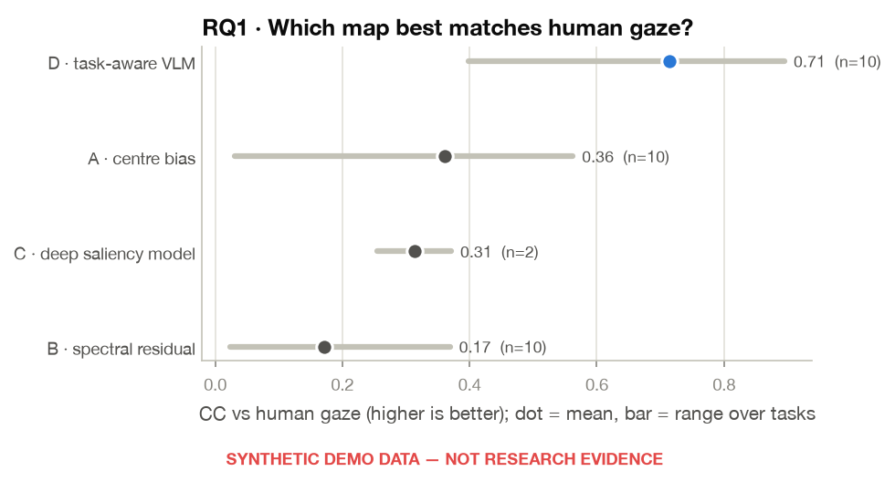 | 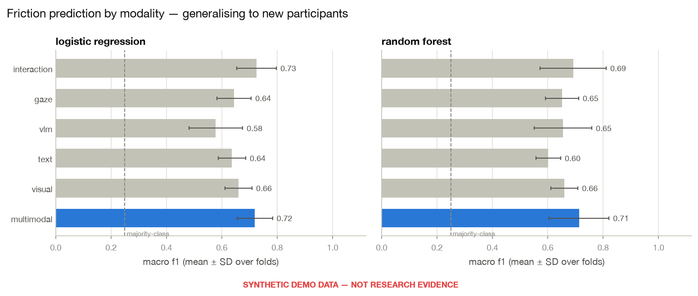 |
| 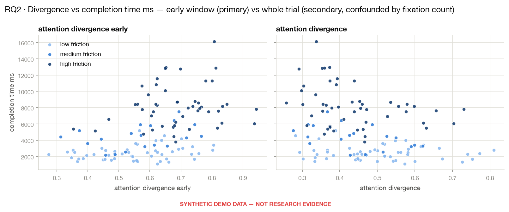 | 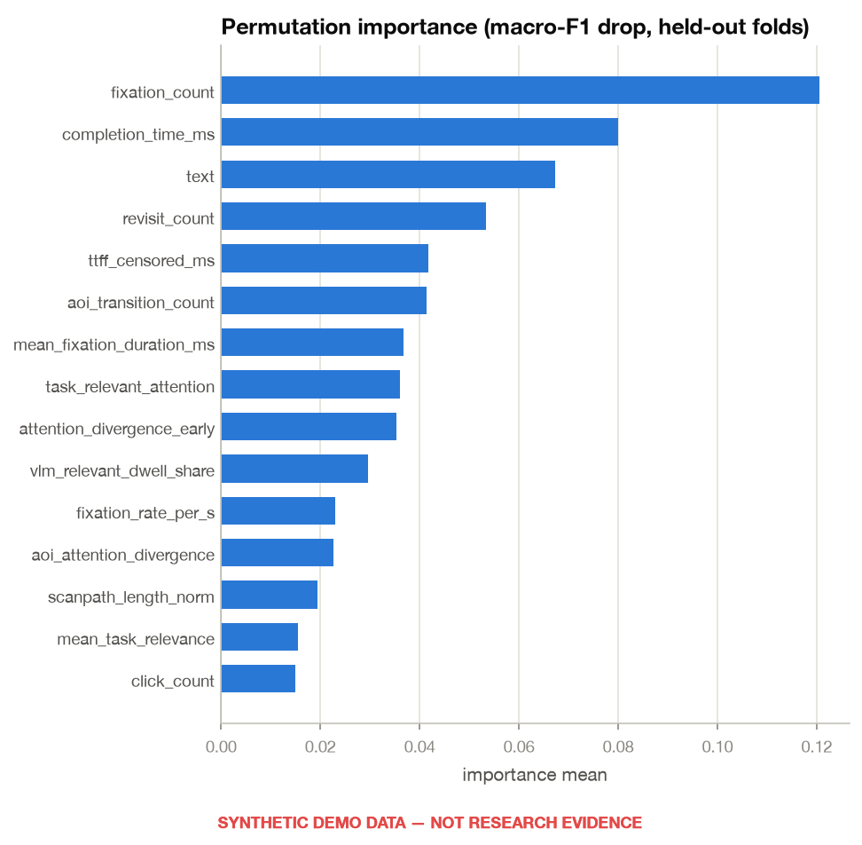 |

Run `python -m gazegrounded.cli evaluate` to generate the full report in `reports/generated/`.
</details>

## Limitations and ethics

- **Gaze is not understanding.** Eye tracking shows where people looked, not what they
  understood. A long look can mean interest or confusion.
- **Webcam accuracy is limited.** Webcam eye tracking is accurate to about 100–200 px. That is
  enough to tell which region someone looked at, but too coarse for small icons or reading.
- **The model's map is an estimate.** It shows where the model expects the task-relevant
  information to be. VLMs can be wrong, and confidently so.
- **Small samples and static stimuli.** Expect small studies, and static screenshots stand in
  for live, multi-step interfaces.
- **Gaze is sensitive data.** The study uses pseudonymous codes and never records video.
  Participants download and send their own data. Only send screenshots to externally hosted
  models if they contain nothing confidential.

See [reports/limitations.md](reports/limitations.md), the
[model card](reports/model_card.md) and the [dataset card](reports/dataset_card.md).

## Roadmap

- [ ] Ethics approval and a pilot with 3–5 participants
- [ ] Main study (24 or more participants, counterbalanced) with coded friction labels
- [ ] Analysis with real vision-language models, including failure-case coding
- [ ] Saliency model trained on UEyes and tested on unseen interfaces
- [ ] Lab eye-tracker replication

## Author

**Morvarid Kaviani** · [www.morvaridkaviani.com](https://www.morvaridkaviani.com)

## Citation

If you use GazeGrounded UX in your research, please cite it using [CITATION.cff](CITATION.cff)
(GitHub shows a "Cite this repository" button).

## Licence

The code is released under the [MIT licence](LICENSE). The browser study loads WebGazer.js
(GPL-3.0-or-later) from a CDN; it is not included in this repository. Third-party datasets and
models keep their own licences.
